# Road and street options: CS2 next to Neighbors (2026-10-26)

**Nathan's words (2026-10-26):** "i want all the same street and road options as CS2"

We take CS2's ideas only. Our names, our art, real US road sizes.

Marks: ✅ already have · 🟢 easy to add · 🟠 big job

## Kinds of roads

| CS2 option | What Neighbors has now | Mark |
|---|---|---|
| Small two-lane road | Street, plus no-parking, divided and brick versions | ✅ |
| Small one-way road | One-way street, 1 lane or 2 lanes | ✅ |
| Alley | Alley behind the homes | ✅ |
| Gravel road | Gravel road | ✅ |
| Dirt road | Dirt road, plus chip-seal and county road | ✅ |
| Medium four-lane road | Avenue | ✅ |
| Medium road with a middle strip | Divided avenue (with trees), center turn lane | ✅ |
| Medium one-way road | One-way avenue (3 lanes) | ✅ |
| Large six-lane road | Boulevard, five-lane strip, parkway | ✅ |
| Large one-way road | One-way boulevard, 4 lanes with parking (added 2026-10-26) | ✅ |
| Highway, one direction | Highway, 2, 3 or 4 lanes | ✅ |
| Two-way highway | Divided highway, state highway | ✅ |
| Highway ramps | Ramp, 1 or 2 lanes, with merges | ✅ |
| Car-free street (people walk, trucks deliver) | Roads > Traffic > Streets > Car-free: click a town street (added 2026-10-26) | ✅ |
| Footpaths and bike paths you draw | Trails exist, but the trail director grows them. You can't draw one | 🟠 |
| Tram tracks, and roads with tram tracks | None. Needs trams, stops, a depot and routes | 🟠 |

## What's on the road

| CS2 option | What Neighbors has now | Mark |
|---|---|---|
| Sidewalks | On every town road, with crosswalks and walk signals | ✅ |
| Bike lanes | Street and avenue with bike lanes | ✅ |
| Bus lanes | Avenue with bus lanes | ✅ |
| Street parking | Parallel parking, and slanted parking on main street | ✅ |
| Parking lots and garages | Built from the Roads menu, real stall sizes | ✅ |
| Street lights | On every road | ✅ |
| Trees and grass in the middle | Divided street, divided avenue, parkway | ✅ |
| Add trees, grass or a wider sidewalk to **any** road | Not yet. Trees grow along the grass strip on their own, but you can't add them to one road | 🟠 (changes how roads are saved) |
| Sound walls along a road | None | 🟠 (changes how roads are saved) |
| Walls for roads cut into a hill, and roads along the water's edge | None | 🟠 |

## Corners and crossings

| CS2 option | What Neighbors has now | Mark |
|---|---|---|
| Traffic lights | Yes, plus your own timing, green waves and lights that sense cars | ✅ |
| Stop signs | Stop signs on the side road, or all-way stops | ✅ |
| Roundabouts | Several real sizes, 1 or 2 lanes | ✅ |
| Bridges, overpasses and tunnels | Raise or lower a road as you draw | ✅ |
| No left turn, no right turn, no U-turn at a corner | Roads > Traffic > Turns > No left / No right (added 2026-10-26). Cars already never U-turn at a corner | ✅ |
| Take away a crosswalk | Roads > Traffic > Turns > Crosswalk: click a road at a corner (added 2026-10-26) | ✅ |

## Drawing tools

| CS2 option | What Neighbors has now | Mark |
|---|---|---|
| Straight | Yes, keeps going from the end | ✅ |
| Simple curve | Yes (start, bend, end) | ✅ |
| S-curve (two bends in one go) | Draw > Curve, then click Curve again (added 2026-10-26) | ✅ |
| Grid | Yes, rectangle or any shape, real block sizes | ✅ |
| Parallel roads | Yes, with the gap you choose | ✅ |
| Upgrade (swap a road for another kind) | Yes, click a road | ✅ |
| Lines that help you line up roads | Yes, guide lines and right angles | ✅ |
| Switches to turn each kind of snapping on or off | Options > Snap roads and Guides, under Parallel (added 2026-10-26) | ✅ |
| Remove roads | Bulldoze | ✅ |

## Tally

- ✅ Have now: 36 (30 before, plus the 6 easy ones built 2026-10-26)
- 🟠 Big job: 5 (draw your own paths, trams, add trees or grass to any road, sound walls, hill walls and waterfront roads)

## The one that can break old towns

"Add trees, grass or a sound wall to any road" means each road piece has to remember extra things, so the way roads are written into a `.city` file changes. If that's done wrong, old towns could load with their roads missing or wrong.

How we'd keep it safe: add the new facts at the end of each road's saved line, so old towns that don't have them still load the old way. A test loads an old town file and checks every road is still there. If it goes wrong, we undo the one merge on main, and towns saved before it still open.

The six easy ones didn't change how roads are saved. Turn bans and crosswalks each add a new item to the save, and old towns simply don't have it.

## The six easy ones, in the game (2026-10-26)

1. One-way boulevard: 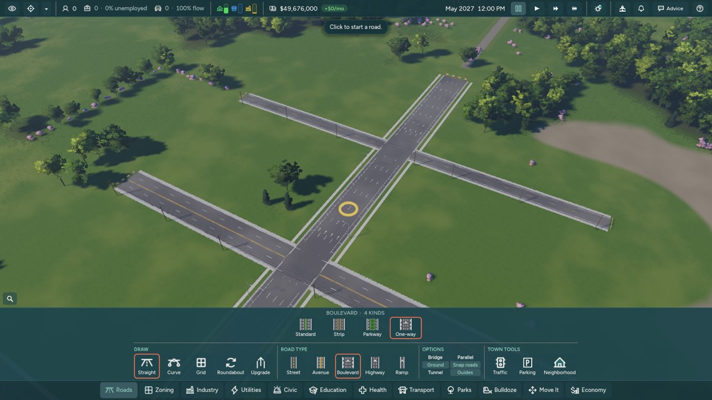 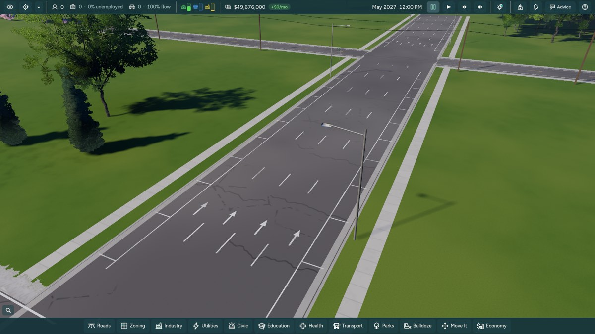
2. S-curve: 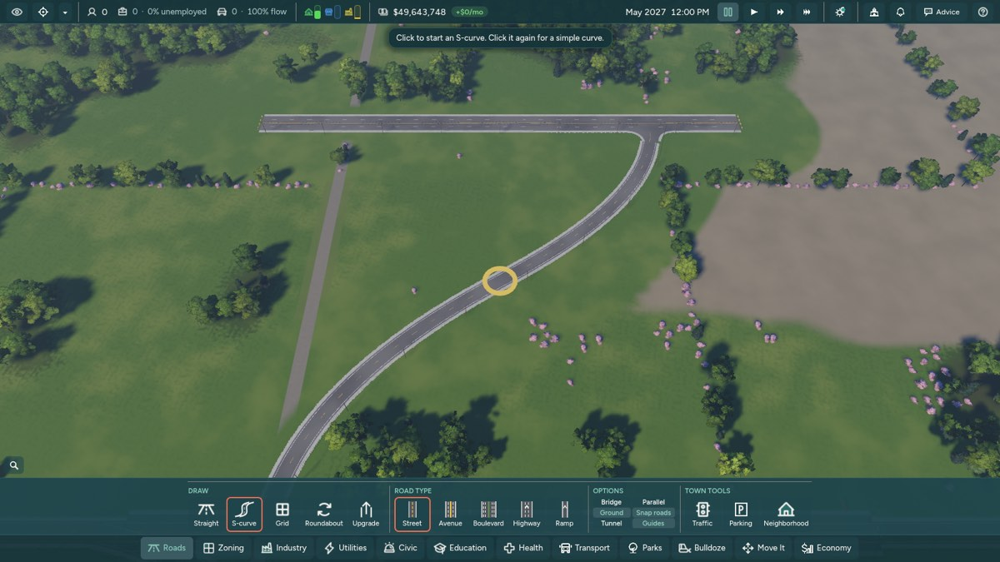 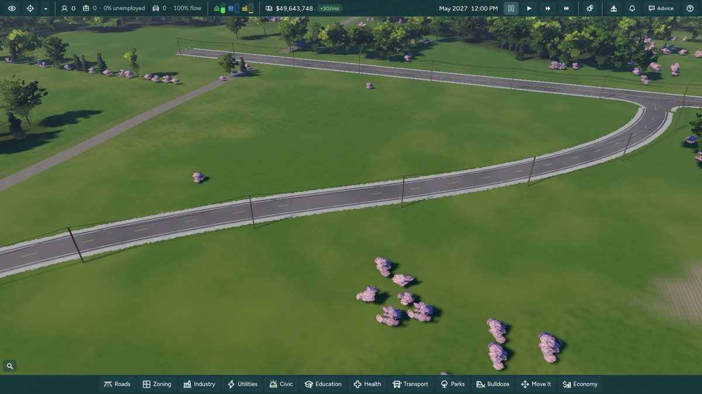
3. Snap switches (Snap roads off here): 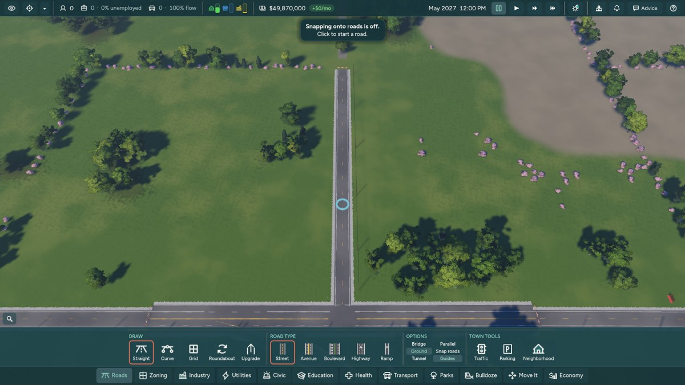
4. Car-free street: 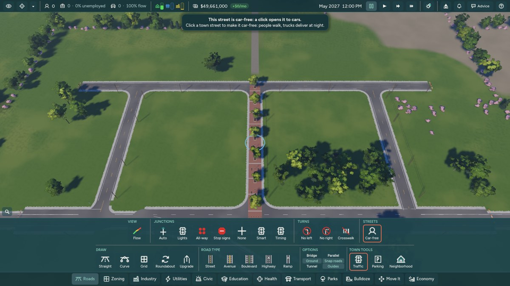 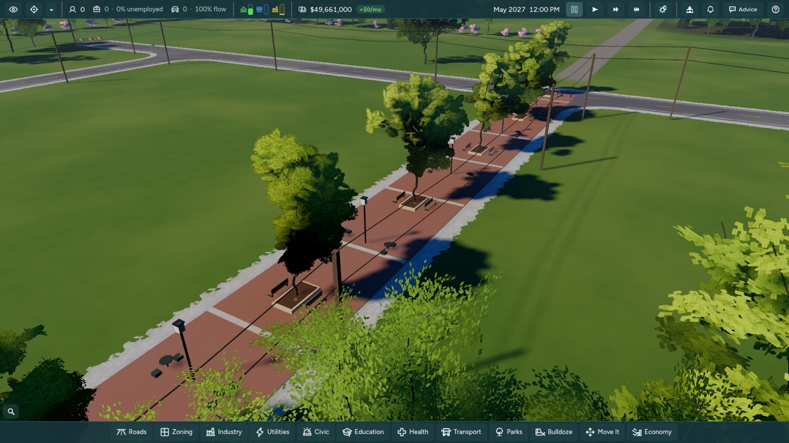
5. No left and no right turn signs: 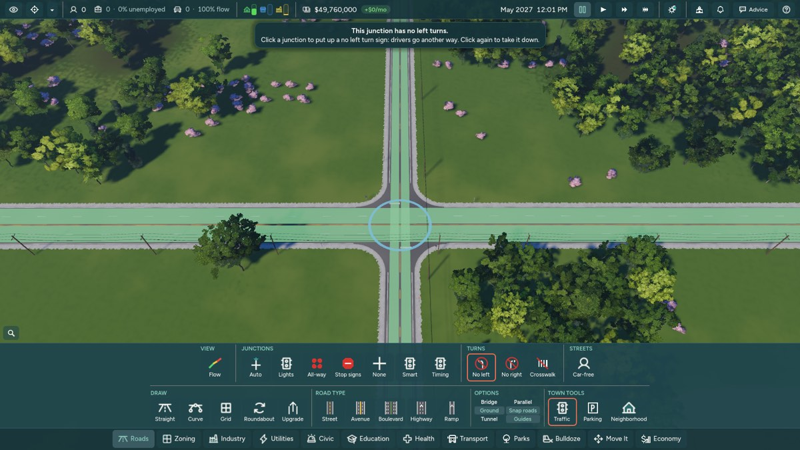 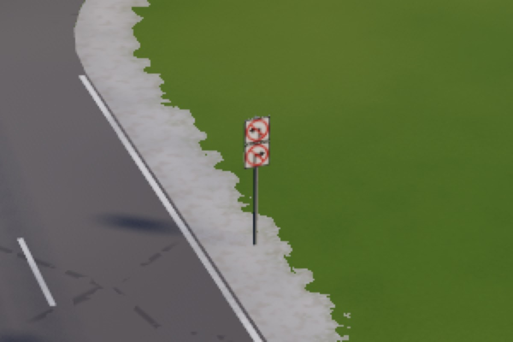
6. A crosswalk taken away (the west one): 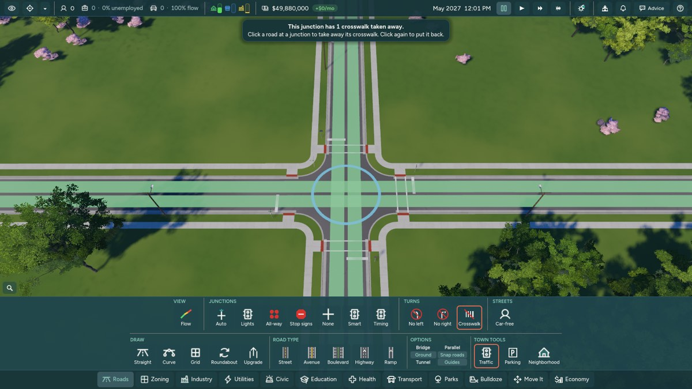 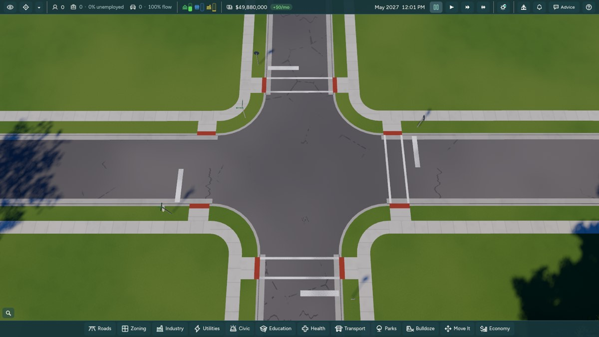

To keep the Roads menu at its 1000 px, the S-curve shares the Curve
button, Parallel sits above the snap switches, and Car-free is in the
Traffic row.

Corners cut:
- When a crosswalk is taken away, that leg's curb ramps stay.
- Car-free streets count toward the trail director's plaza limit.
